# Anode Data Flow Diagrams

This document provides comprehensive data flow diagrams for understanding how data moves through the Anode distributed object storage system. These diagrams illustrate the complete request lifecycle for various operations including reads, writes, multipart uploads, replication, cluster changes, and failover scenarios.

## Table of Contents

- [System Overview](#system-overview)
- [Write Path (PUT Object)](#write-path-put-object)
- [Read Path (GET Object)](#read-path-get-object)
- [Multipart Upload Flow](#multipart-upload-flow)
- [Raft Replication Flow](#raft-replication-flow)
- [Cluster Membership Changes](#cluster-membership-changes)
- [Failover Scenarios](#failover-scenarios)

## System Overview

### Overall System Data Flow

This high-level diagram shows how data flows through the major components of an Anode node:

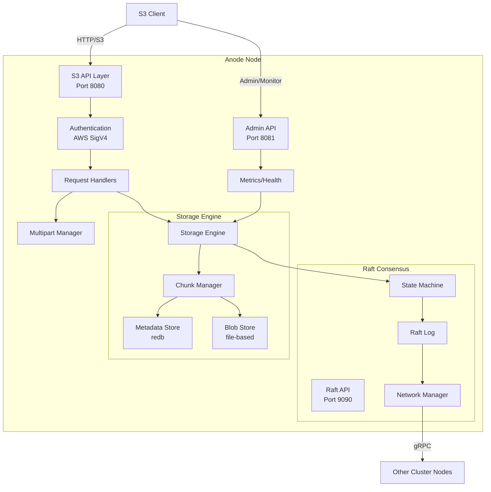

**Key Data Paths:**
- **S3 Requests**: Client → S3 API → Auth → Handlers → Storage Engine
- **Replication**: Storage Engine → Raft State Machine → Raft Log → Network → Other Nodes
- **Storage**: Chunk Manager → Metadata Store (for manifests) + Blob Store (for data)
- **Monitoring**: Admin API → Metrics → Storage Engine

## Write Path (PUT Object)

### Complete PUT Object Flow

This diagram shows the end-to-end data flow when a client uploads an object to Anode:

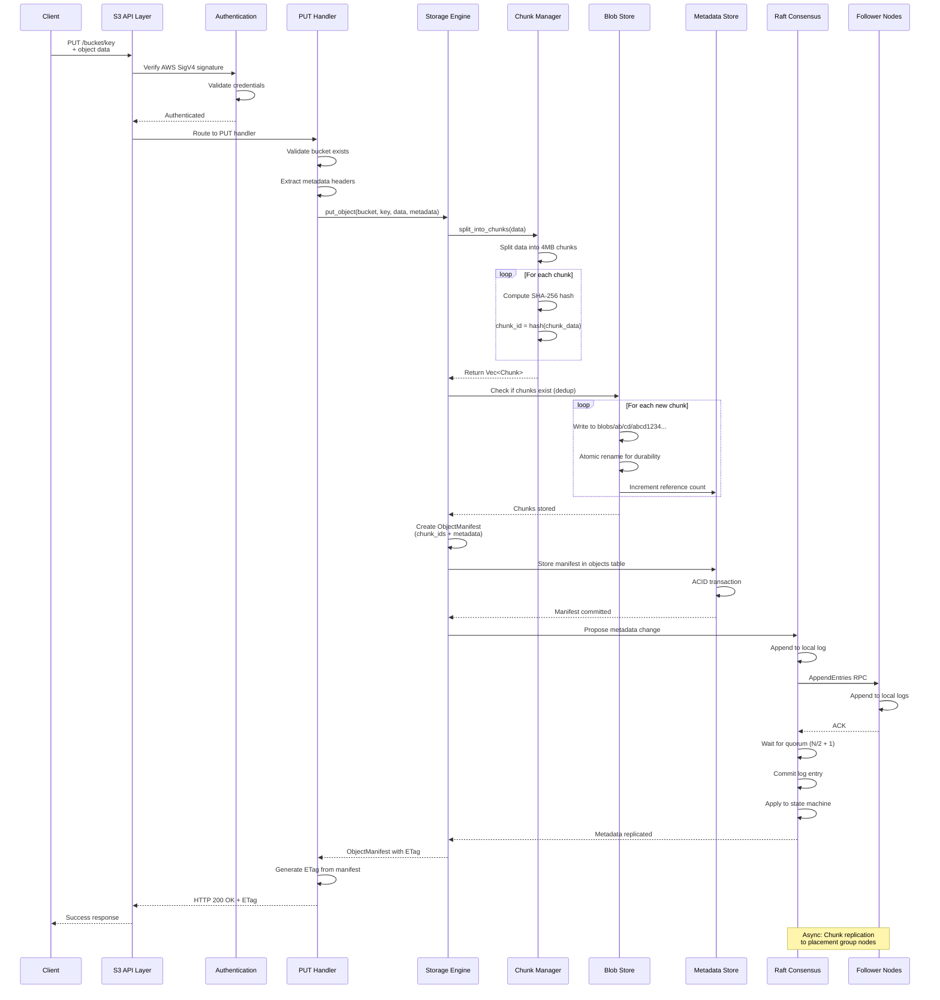

**Key Steps Explained:**

1. **Authentication** (Lines 2-5): AWS SigV4 signature verification ensures the request is from an authorized user
2. **Chunking** (Lines 11-16): Data is split into 4MB chunks and each chunk is hashed with SHA-256
3. **Deduplication** (Lines 18-23): Chunks are deduplicated by checking if the hash already exists
4. **Manifest Creation** (Lines 26-29): An ObjectManifest records the list of chunk IDs that compose the object
5. **Raft Replication** (Lines 31-40): Metadata is replicated through Raft consensus for strong consistency
6. **Response** (Lines 42-44): Client receives success only after quorum commits the metadata

**Performance Characteristics:**
- **Latency**: Typically 10-100ms depending on object size and cluster configuration
- **Throughput**: Limited by chunk hashing speed and network bandwidth
- **Deduplication**: Identical chunks are only stored once, saving storage space

## Read Path (GET Object)

### Complete GET Object Flow

This diagram shows how an object is retrieved from Anode:

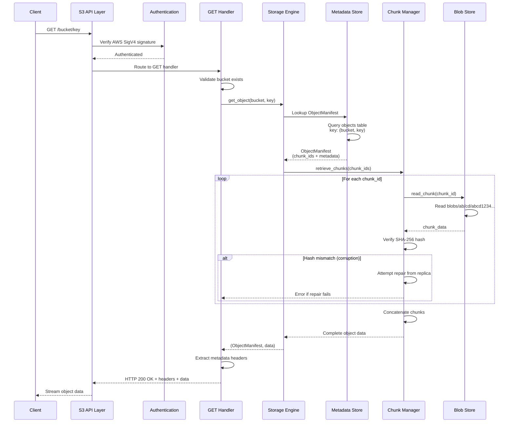

**Key Steps Explained:**

1. **Manifest Lookup** (Lines 7-10): The metadata store is queried to find which chunks compose the object
2. **Chunk Retrieval** (Lines 12-21): Each chunk is read from the blob store and verified
3. **Integrity Verification** (Lines 17-21): SHA-256 hash verification ensures data hasn't been corrupted
4. **Reassembly** (Line 22): Chunks are concatenated in order to reconstruct the original object
5. **Streaming** (Line 27): Data is streamed back to the client efficiently

**Performance Characteristics:**
- **Latency**: 5-50ms for small objects, scales with object size
- **Throughput**: Limited by disk I/O and network bandwidth
- **Integrity**: All data is verified on read, corruption is detected immediately

### Range Request (Partial Object Read)

For range requests (e.g., reading bytes 1000-2000 of an object):

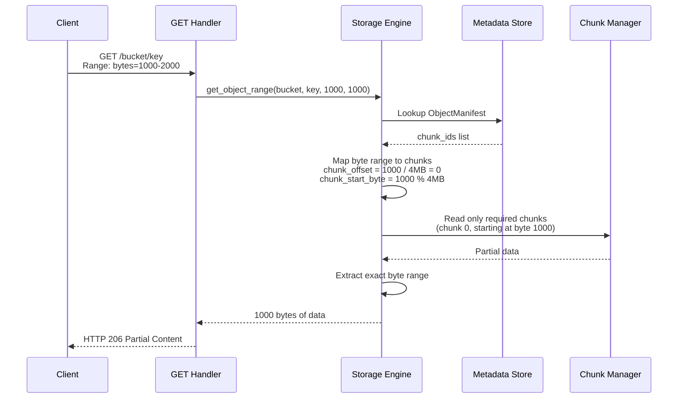

**Benefits:**
- **Efficiency**: Only reads necessary chunks, not the entire object
- **Parquet Optimization**: Critical for reading Parquet row groups without full file download
- **Bandwidth Savings**: Reduces network transfer for large files

## Multipart Upload Flow

### Multipart Upload Complete Flow

Multipart uploads allow clients to upload large objects (>5GB) in parts. This diagram shows the complete lifecycle:

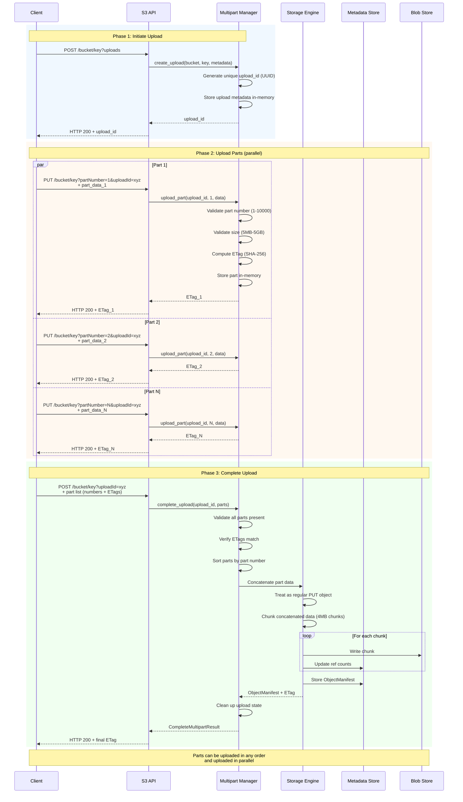

**Key Phases:**

1. **Initiate** (Lines 2-9): Client requests an upload ID and provides metadata
2. **Upload Parts** (Lines 11-38): Parts can be uploaded in parallel, in any order
3. **Complete** (Lines 40-62): All parts are concatenated and stored as a single object

**Advantages:**
- **Parallelism**: Multiple parts can be uploaded simultaneously
- **Resumability**: Failed parts can be retried without re-uploading the entire object
- **Large Files**: Supports objects up to 5TB (10,000 parts × 5GB/part)

### Abort Multipart Upload

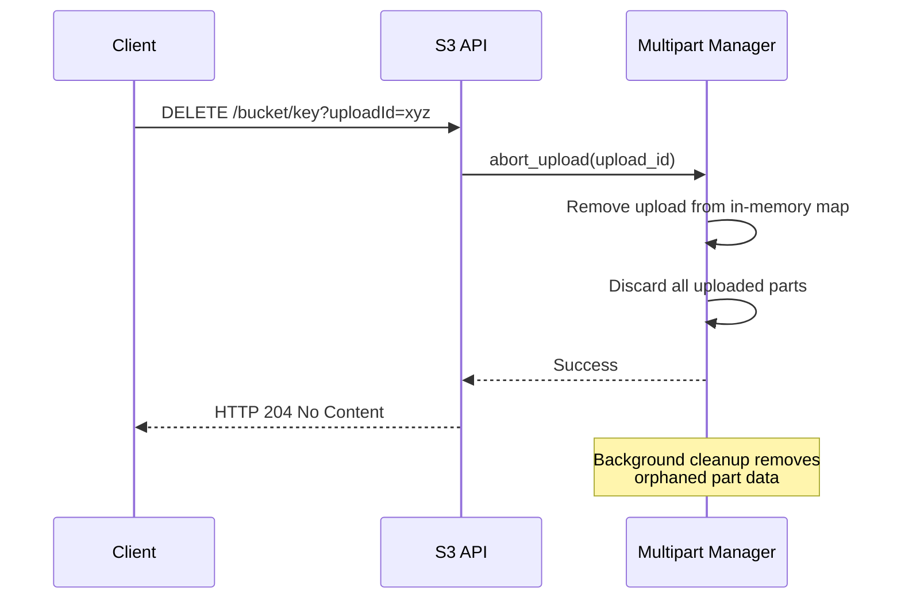

## Raft Replication Flow

### Metadata Replication via Raft

This diagram shows how metadata changes are replicated across the cluster using Raft consensus:

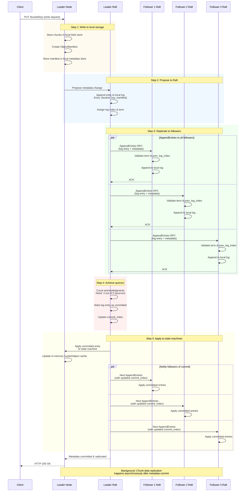

**Raft Guarantees:**

- **Linearizability**: All metadata operations are strictly ordered
- **Quorum Commit**: Changes are durable once majority acknowledges
- **Leader Election**: New leader elected within 3-10 seconds on failure
- **Log Consistency**: All nodes apply entries in the same order

### Background Chunk Replication

After metadata is committed, chunk data is replicated asynchronously:

```mermaid
graph LR
    subgraph "Leader Node"
        Leader[Storage Engine]
        BlobStore1[Blob Store]
    end

    subgraph "Placement Group"
        PG[Placement Group<br/>hash(bucket+key) % 128]
    end

    subgraph "Replica Node 1"
        Replica1[Storage Engine]
        BlobStore2[Blob Store]
    end

    subgraph "Replica Node 2"
        Replica2[Storage Engine]
        BlobStore3[Blob Store]
    end

    Leader -->|1. Identify PG nodes| PG
    PG -->|2. Send chunks| Replica1
    PG -->|2. Send chunks| Replica2

    Replica1 -->|3. Verify hashes| BlobStore2
    Replica2 -->|3. Verify hashes| BlobStore3

    BlobStore2 -->|4. ACK| Leader
    BlobStore3 -->|4. ACK| Leader

    Leader -->|5. Update replication status| BlobStore1
```

**Replication Process:**

1. **Placement Group Selection**: Object is assigned to a PG based on hash(bucket + key)
2. **Node Selection**: Replication factor nodes are chosen from the PG assignment
3. **Chunk Transfer**: Chunks are sent to replica nodes via gRPC
4. **Verification**: Replicas verify chunk hashes before acknowledging
5. **Status Tracking**: Leader tracks which chunks have achieved replication factor

## Cluster Membership Changes

### Adding a Node to the Cluster

This diagram shows the complete process of adding a new node to an existing cluster:

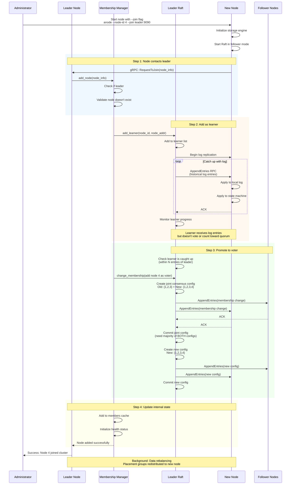

**Key Stages:**

1. **Learner Phase** (Lines 13-29): New node receives log entries but doesn't participate in voting
2. **Joint Consensus** (Lines 31-49): Raft uses two-phase membership change to ensure safety
3. **Full Member** (Lines 51-55): Node becomes a voting member of the cluster

**Safety Guarantees:**
- **No Split Brain**: Joint consensus ensures old and new configs both have quorum
- **Availability**: Cluster remains available during membership change
- **Consistency**: Log replication continues uninterrupted

### Removing a Node from the Cluster

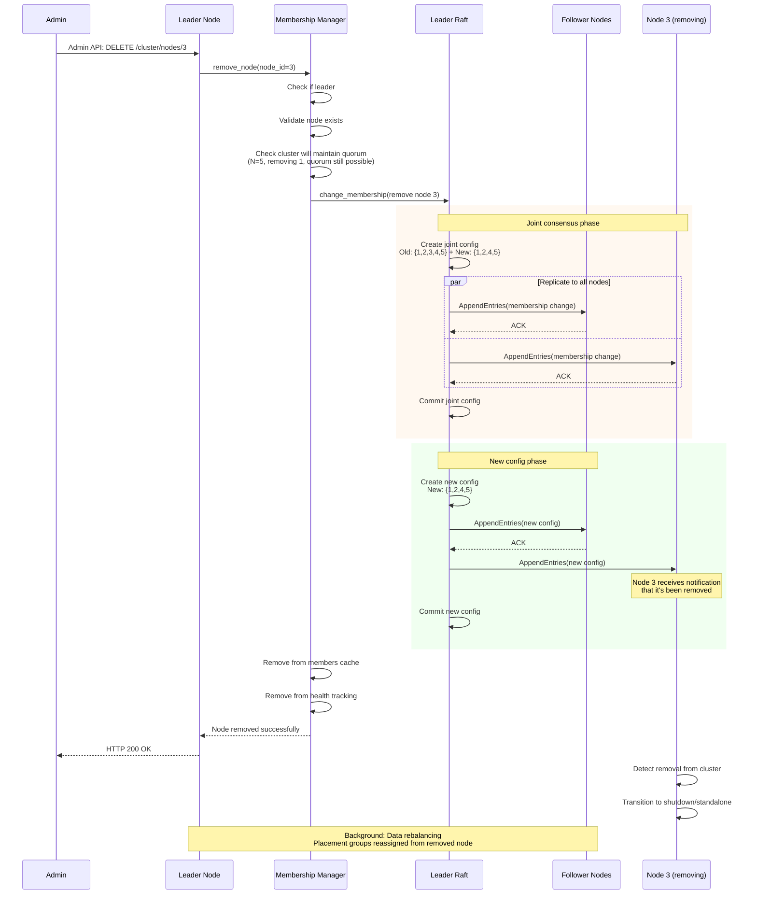

**Important Considerations:**
- **Quorum Preservation**: Cannot remove a node if it would prevent quorum
- **Data Migration**: Placement groups must be reassigned before removal
- **Graceful Shutdown**: Removed node should cleanly shutdown after detecting removal

## Failover Scenarios

### Leader Failure and Election

This diagram shows what happens when the leader node fails:

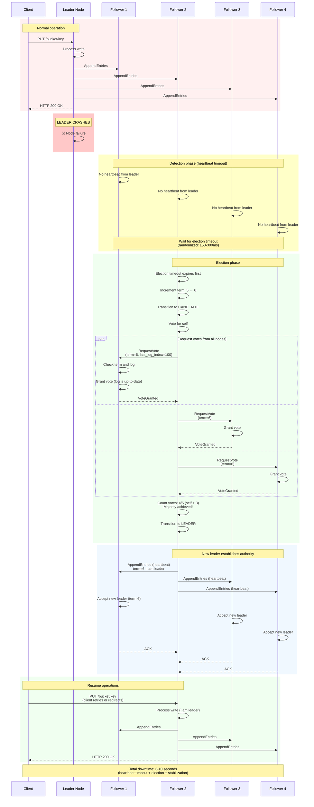

**Timeline:**
1. **T+0s**: Leader fails
2. **T+0-1.5s**: Heartbeat timeout (followers detect missing leader)
3. **T+1.5-3s**: Election process (RequestVote RPCs)
4. **T+3-5s**: New leader establishes authority
5. **T+5s+**: Normal operation resumes

**Client Impact:**
- Writes in progress may fail and need retry
- Reads may return stale data during election
- 3-10 second window of unavailability for writes

### Follower Failure

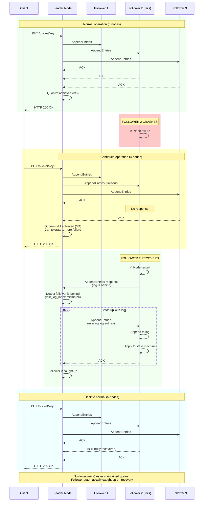

**Key Points:**
- **No Downtime**: Cluster continues serving requests as long as quorum is maintained
- **Automatic Recovery**: Follower automatically catches up when it restarts
- **Degraded Redundancy**: Fault tolerance is reduced during failure (can tolerate N/2-1 failures)

### Network Partition (Split Brain Prevention)

This shows how Raft prevents split brain during a network partition:

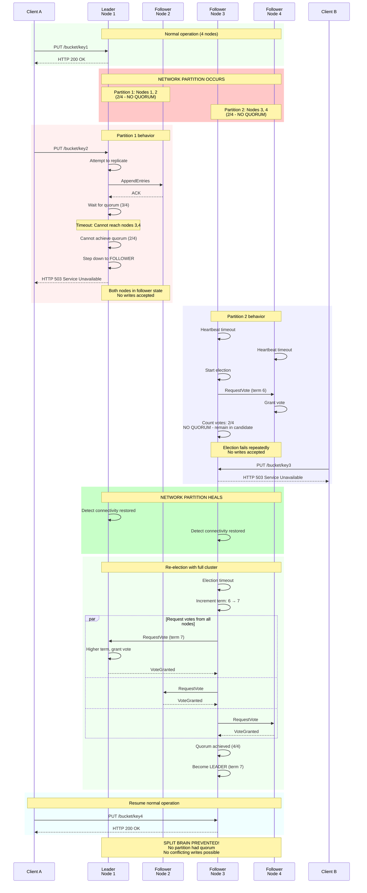

**Safety Properties:**
- **No Split Brain**: Neither partition can achieve quorum, preventing divergent writes
- **Consistency Maintained**: No conflicting states can occur
- **Availability Traded**: Writes unavailable during partition (CP in CAP theorem)
- **Automatic Recovery**: Normal operation resumes when partition heals

**Partition Scenarios:**

| Cluster Size | Partition | Quorum Needed | Can Accept Writes? |
|--------------|-----------|---------------|--------------------|
| 3 nodes | 2 vs 1 | 2 | Partition with 2 nodes: YES<br/>Partition with 1 node: NO |
| 5 nodes | 3 vs 2 | 3 | Partition with 3 nodes: YES<br/>Partition with 2 nodes: NO |
| 5 nodes | 2 vs 2 vs 1 | 3 | All partitions: NO |

## Summary

These diagrams illustrate the complete data flow through Anode for various operations:

### Key Takeaways

1. **Write Path**:
   - Objects are chunked (4MB), deduplicated, and stored in content-addressed blob store
   - Metadata is replicated via Raft for strong consistency
   - Chunk data is replicated asynchronously after metadata commit

2. **Read Path**:
   - Metadata lookup is fast (local redb query)
   - Chunks are verified on read with SHA-256 hashes
   - Range requests read only necessary chunks

3. **Multipart Uploads**:
   - Supports large objects (>5GB) with parallel part uploads
   - Parts stored in-memory until completion
   - Final object is chunked and stored like normal PUT

4. **Raft Replication**:
   - Metadata changes go through Raft consensus
   - Quorum commit ensures durability
   - Log replication keeps all nodes consistent

5. **Cluster Membership**:
   - Joint consensus prevents split brain during changes
   - New nodes added as learners first, then promoted to voters
   - Removing nodes requires maintaining quorum

6. **Failover**:
   - Leader failure triggers election (3-10 second downtime)
   - Follower failure has no impact if quorum maintained
   - Network partitions safely prevent split brain by requiring quorum

### Performance Characteristics

| Operation | Latency | Throughput | Notes |
|-----------|---------|------------|-------|
| PUT object (small) | 10-100ms | 1000-5000 ops/sec | Includes Raft replication |
| GET object (small) | 5-50ms | 5000-10000 ops/sec | Local read, hash verification |
| PUT object (large) | Network limited | ~replication_factor | Bandwidth divided by replicas |
| Multipart part | 5-50ms per part | Parallel uploads | Limited by network/disk |
| Raft commit | 5-20ms | ~10000 ops/sec | Depends on cluster size |
| Leader election | 3-10 seconds | N/A | Randomized timeout prevents collisions |

### Design Philosophy

Anode's data flow prioritizes:
- **Strong Consistency**: Raft ensures all nodes agree on metadata
- **Efficiency**: Content-addressed storage enables automatic deduplication
- **Simplicity**: Unified architecture keeps data paths straightforward
- **Safety**: Hash verification and quorum commits prevent data loss
- **Performance**: Async chunk replication and local reads optimize throughput
